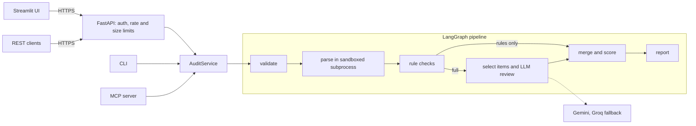

# AccessLens

**Audit Word documents for accessibility issues and get a prioritized fix list, mapped to WCAG 2.2.**

> Status: feature-complete and tested; not yet deployed. The AI-review accuracy numbers are pending real API keys (see [Results](#results)).

## What it does
Upload a .docx and AccessLens reports issues like missing or useless alt text, broken heading structure, unclear link text, tables without headers, low-contrast text, and hard-to-read passages, each with its location, why it matters, and how to fix it.

- **Rules first:** 23 clear-cut checks are deterministic and fast.
- **AI for judgment calls:** an LLM reviews alt text against the actual image, flags unclear links and unexplained jargon, and suggests plain-language rewrites. It has no tools and can only *add* findings; it can never remove or change a rule finding.
- **Use it anywhere:** web app, REST API, CLI, or as an MCP tool from Claude and other AI assistants. All four call one `AuditService`, and a test checks they return identical findings.

## Quick start
```bash
make setup                                   # uv sync --all-extras

# CLI: exit 0 = nothing critical/high, 1 = critical/high found, 2 = error
uv run accesslens audit report.docx --rules-only
uv run accesslens audit docs/ --format html --out reports/

# REST API (needs at least one API key; store only its hash)
uv run python -c "from accesslens.api.auth import hash_key; print(hash_key('choose-a-secret'))"
API_KEYS_SHA256=<that hash> make run-api     # http://127.0.0.1:8000/docs in dev

# Web UI (a client of the API)
ACCESSLENS_API_KEY=choose-a-secret make run-ui

# MCP server over stdio (set MCP_ALLOWED_DIR to the folder it may read)
MCP_ALLOWED_DIR=/path/to/docs make run-mcp
```
AI review needs `GEMINI_API_KEY`, `GROQ_API_KEY` and the model names in `.env` (copy `.env.example`). Without them everything still works in rules-only mode. For containers, `docker compose up --build` runs the hardened API and UI images (read-only filesystem, non-root).

## How it works

Uploads are validated before parsing (zip bombs, DOCTYPE and XXE tricks, macros, zip-slip) and parsed in a resource-limited child process. Document text reaches the LLM only inside escaped `<document_item>` tags, after PII masking, and its output must pass a schema that allows only five rule ids.

## Results
Rules-only evaluation on the generated corpus (30 synthetic documents with planted issues, 5 clean controls, 5 prompt-injection documents; 79 planted rule-based issues), commit and date in [`eval/results/`](eval/results/):

| Measure | Result | Target |
|---|---|---|
| Recall (rule-based checks) | 100% (79 of 79) | ≥ 98% |
| Precision | 100% | ≥ 95% |
| False positives per clean document | 0.00 | ≤ 0.5 |
| AI-review agreement (IMG-003, LNK-003, TXT-006) | not measured yet | ≥ 80% |
| Prompt-injection successes | not measured against a real model yet | 0 |
| One rules-only audit, hardened container | about 0.9 s | p95 ≤ 3 s |
| 10 concurrent rules-only audits | 60 of 60 succeeded; p95 3.56 s before a later speed-up, re-measurement pending | p95 ≤ 3 s |

Quality gates: 269 tests pass on Linux (96% coverage), plus ruff, strict mypy, bandit, pip-audit and gitleaks in CI.

**Read these numbers carefully.** The corpus was generated by the same author who wrote the rules, so a perfect score shows the pipeline works and the block-order convention is consistent; it does not predict accuracy on real documents. Real-world documents are the next test, and the heuristic checks (fake headings, reading grade, contrast) are the ones most likely to be wrong there. The AI-review checks have been tested with a fake model only; their accuracy, and resistance to injection, are unmeasured until they run against a real model (`make eval-llm`).

## Privacy
Documents are never stored, and logs never contain document text. In AI mode, short text excerpts (with emails, phone numbers and long numbers masked; names are **not** detected) and images that have alt text are sent to the configured LLM provider. Images cannot be redacted. Free tiers may use prompts to improve the provider's products, so don't upload confidential documents to the public demo. **Rules-only mode** sends nothing to any AI service.

## Limitations
- English documents only; .docx only (no PDF or PowerPoint).
- Contrast, font size and bold checks read formatting set directly on text. Colours and sizes inherited from styles or themes are not resolved, and colour used alone to convey meaning (WCAG 1.4.1) is not checked.
- Text inside images is read only through the AI alt-text review; scanned pages and charts are not analysed.
- Images and links inside table cells are attributed to the table, not the cell.
- It checks common problems; it is not a complete accessibility audit and does not replace testing with assistive technology.
- The parser's 512 MB memory cap is enforced on Linux only. On Windows only the time limit applies.
- Rate limiting is in memory per process, so it resets on restart and is not shared between instances.

## Documentation
| Doc | Purpose |
|---|---|
| [PRD](docs/01-PRD.md) | What and why |
| [TRD](docs/02-TRD.md) | Architecture and technical design |
| [Security](docs/03-SECURITY.md) | Threat model and controls |
| [Rules catalog](docs/04-RULES-CATALOG.md) | Every check and its WCAG mapping |
| [Evaluation](docs/05-EVALUATION.md) | How accuracy is measured |
| [Roadmap](docs/06-ROADMAP.md) | Phases and checklist |
| [Engineering standards](docs/07-ENGINEERING-STANDARDS.md) | Code, tests, CI |
| [Decisions](docs/08-DECISIONS.md) | Why each choice was made |
| [Security policy](SECURITY.md) | How to report a vulnerability |
| [Changelog](CHANGELOG.md) | What changed |

## License
MIT
